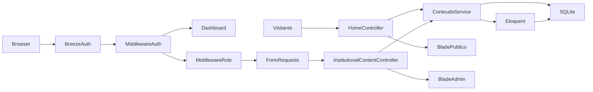

# Guia de execução e fluxo — ORI Institucional

## Visão geral

Aplicação institucional separada do aplicativo Android, das Firebase Functions e do scaffold existente em `web/`. A área pública é renderizada em Blade e consulta apenas conteúdos institucionais ativos. A área autenticada usa Laravel Breeze para login, cadastro, logout, recuperação de senha e perfil. O papel `admin` libera o CRUD; o papel padrão `user` acessa somente seu painel/perfil. A área administrativa não lê nem grava dados pessoais do aplicativo móvel.

Stack efetivamente instalada: Laravel Framework 13.42.0, PHP 8.3 (validado com CLI 8.3.36), Laravel Breeze 2.4.2, Blade, Tailwind CSS 3.4.19, Vite 7.3.8, SQLite, Node 24.19.0 e npm 11.6.2. O projeto foi inicialmente montado em uma pasta de trabalho e será entregue neste diretório independente `institutional-site/`.

## Requisitos

- PHP 8.3 ou superior, com `pdo_sqlite`, `sqlite3`, `mbstring`, `openssl`, `fileinfo`, `tokenizer`, `xml`, `ctype`, `curl` e `zip` habilitados.
- Composer 2, Node.js/npm compatíveis com Vite 7.
- Windows PowerShell, macOS ou Linux; exemplos abaixo usam PowerShell.

## Instalação local (Windows PowerShell)

A partir da pasta `institutional-site`:

```powershell
Copy-Item .env.example .env
New-Item -ItemType File -Path database/database.sqlite -Force
composer install
php artisan key:generate
php artisan migrate --seed
npm install
npm run build
php artisan serve
```

Abra `http://127.0.0.1:8000`. `database/database.sqlite` é o banco SQLite padrão. `migrate --seed` cria o esquema e os dez conteúdos iniciais; rodar novamente atualiza esses dez registros pelo identificador estável `seed_key`, sem duplicá-los. As migrations não apagam conteúdo editorial existente. Em ambiente de produção, use `APP_DEBUG=false`, HTTPS, backup do SQLite e permissões restritas ao arquivo do banco. Nunca publique `.env`.

Para desenvolvimento com atualização do frontend, use `npm run dev` em outro terminal e deixe `php artisan serve` rodando.

## Criar o primeiro administrador

Edite somente o `.env` local e configure `ORI_ADMIN_NAME`, `ORI_ADMIN_EMAIL` e `ORI_ADMIN_PASSWORD`. A senha deve ter pelo menos 12 caracteres e incluir letras maiúsculas e minúsculas, número e símbolo. Então rode:

```powershell
php artisan db:seed --class=AdminUserSeeder
```

O seeder valida os três valores, armazena a senha com hash e atribui papel `admin`. Sem as três variáveis, não cria conta. Ele é idempotente por e-mail; a execução não redefine a senha de uma conta existente. Remova as variáveis do ambiente depois da criação. Não há credenciais padrão fornecidas ou configuradas na entrega. O cadastro público sempre cria papel `user`; a role não é preenchível no formulário.

Acesse `/login` com a conta administradora e depois `/dashboard`. A tela administrativa e o CRUD ficam em `/admin/contents`. Um usuário comum recebe 403 ao tentar rotas administrativas.

## Fluxo e arquitetura



- **Rotas**: `routes/web.php` separa landing page, páginas autenticadas e CRUD sob `auth` + `role:admin`; Breeze concentra rotas de autenticação.
- **Autenticação**: sessão Laravel/Breeze, hash de senha, redefinição de senha. Não foi habilitada exigência de e-mail verificado. O ambiente inicial usa `MAIL_MAILER=log`; link de redefinição é registrado em `storage/logs/laravel.log`. Configure um SMTP antes de oferecer recuperação por e-mail em produção.
- **Autorização**: `EnsureUserRole` bloqueia contas sem papel exigido; os Form Requests também autorizam operações editoriais. A criação pública não aceita role.
- **Validação**: `StoreInstitutionalContentRequest` e `UpdateInstitutionalContentRequest` validam e autorizam os dados antes de chegar ao controller.
- **Serviço**: `InstitutionalContentService` concentra consultas públicas, gravação e estatísticas do painel.
- **Persistência**: Eloquent grava em `institutional_contents` e `users` no SQLite. Conteúdos inativos não são expostos na página pública. A rota fallback retorna 404.
- **Front-end**: Blade, Tailwind e CSS responsivo; Vite compila os arquivos para `public/build`.

## Conteúdo institucional

O seeder instala dez registros versionáveis e administráveis: Quem somos; Problema e motivação; Objetivos; Rotina; Comunicação/CAA; Personalização; Fundamentação e acessibilidade; Arquitetura e tecnologias; Metodologia e avaliação; Equipe, contexto acadêmico e estágio atual. Cada registro tem seção, título, selo, resumo, detalhes, ordem, situação ativa e identificador interno de semeadura. A interface administrativa oferece listagem, criação, edição, visualização e exclusão, além de estatísticas e lista de atualizações.

As referências acadêmicas e DOI estão incluídos na landing page. Os textos distinguem objetivos, descrição do artigo e resultados efetivamente observados. O índice do protocolo funcional planejado é aprovados/(aprovados + reprovados) × 100; bloqueados e não executados ficam fora do denominador e são reportados separadamente. O artigo não relata execução desses testes e, por isso, o site não afirma eficácia, usabilidade validada, acessibilidade comprovada ou aumento de autonomia.

## Identidade visual e fotos da equipe

A identidade visual usa `public/images/ori-logo.svg`, convertido do VectorDrawable `ori.xml` fornecido pela equipe, com a marca `ori`, a frase “Seu Apoio. Sempre.” e o slogan “organizar • comunicar • cuidar”. A interface segue a paleta clara do app e aplica o tema escuro do sistema quando `prefers-color-scheme: dark` estiver ativo. Usa Nunito para a marca e Nunito Sans no restante, botões em formato de pílula, áreas de toque amplas e cartões sem sombra. As telas de autenticação usam utilitários Tailwind e seguem o padrão visual do wireframe de login. A seção da equipe tem quatro placeholders acessíveis para as fotos ainda não fornecidas; os arquivos podem ser organizados em `public/images/team/` e as divs `.team-photo-placeholder` da seção `#equipe` substituídas por imagens com texto alternativo.

## Divergência documental registrada

As fontes não descrevem o mesmo estágio. O README do repositório deixa rotina, comunicação e vínculos como “em desenvolvimento”; o artigo final declara os requisitos FR01–FR11 implementados, embora não relate testes formais. A cópia pública consultada contém tela/ViewModel de rotina e modelos de tarefa/vínculo, mas arquivos presentes não provam fluxos completos. O artigo também afirma que as regras do Firestore foram implementadas; na cópia do repositório consultada não foi encontrado `firestore.rules` nem configuração de implantação das regras. Assim, não foi possível inspecionar sua implementação. Cloud Functions está inicializado, sem funções de negócio implementadas na versão consultada. Essa limitação é exposta na seção de estágio do site.

As informações acadêmicas derivam do artigo final do 9º EnGeTec da Fatec Zona Leste e da análise do repositório oficial; discrepâncias são apontadas em vez de tratadas como fatos equivalentes.

## Comandos úteis

```powershell
php artisan route:list --except-vendor
php artisan test
php artisan db:seed --class=InstitutionalContentSeeder
npm run build
```

`migrate:fresh` remove todas as tabelas e dados do banco apontado e deve ser reservado a um banco local descartável. Não use em produção.

## Verificações realizadas nesta entrega

- `php artisan migrate:fresh --seed --force`: migrations e dez conteúdos executados com sucesso; o seeder de administrador foi ignorado porque não havia credenciais ORI_ADMIN_* configuradas.
- `php artisan test --compact`: **38 testes aprovados, 111 assertions**.
- `npm run build`: compilação de produção concluída.
- `php artisan route:list --except-vendor`: rotas públicas, Breeze, dashboard, perfil e CRUD listadas.
- Revisão responsiva manual: viewport desktop 1440×900 e móvel 390×844; menu móvel abre/fecha e formulário de login cabe no viewport sem overflow horizontal observado.

Na sandbox usada para executar os testes, o PHP reportava `is_writable`/`is_readable` como falso para caminhos graváveis/legíveis. Para viabilizar a execução local, foram feitas adaptações temporárias somente no `vendor/` descartável, substituindo aquelas verificações por verificações de diretório/arquivo. Essas alterações não fazem parte do código-fonte entregue e `vendor/` não é distribuído; em uma instalação normal, Composer instala os arquivos originais do framework. Portanto, a suíte foi executada contra a aplicação, com esse contorno específico do ambiente de execução documentado.

## Limitações

- O artigo não apresentou execução de testes funcionais, avaliação com população-alvo ou evidência de resultado de acessibilidade/benefício; a plataforma não reivindica esses resultados.
- A instalação padrão envia mensagens de reset para o log local, não para um serviço de e-mail.
- O painel administra conteúdo deste site. Ele não administra Firebase, contas do app Android nem regras de autorização do ORI mobile.
- Nenhum administrador é incluído previamente. Configure os segredos no `.env` de cada instalação.
